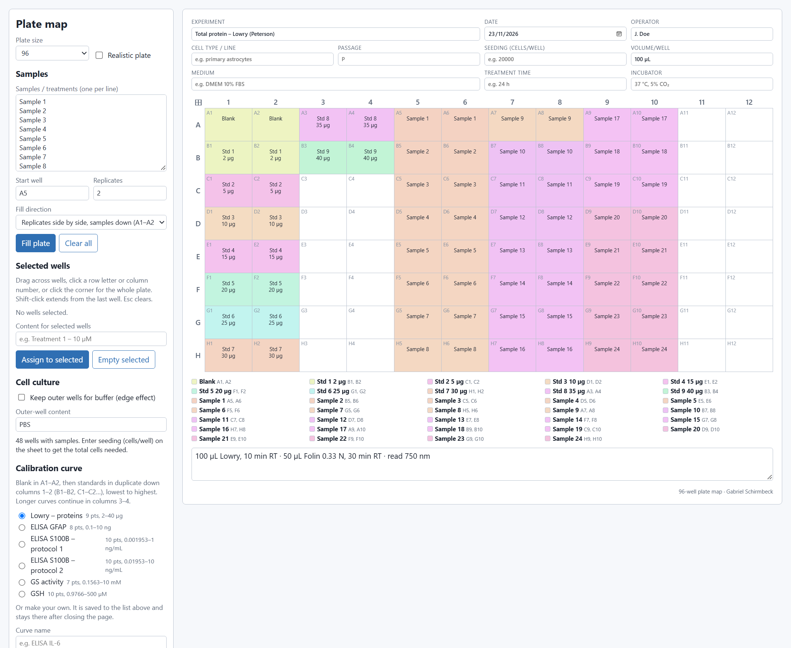
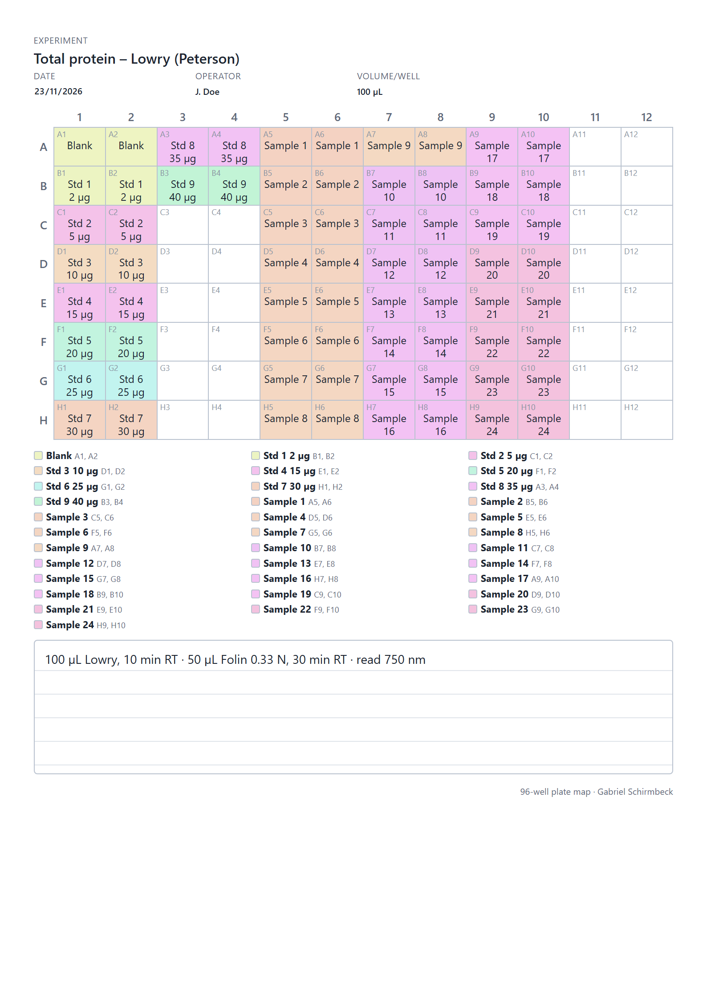
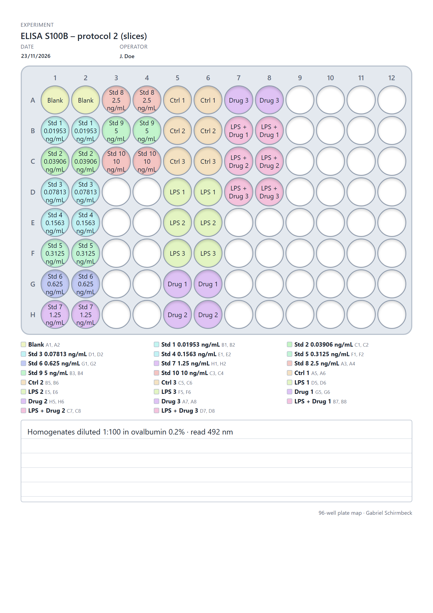
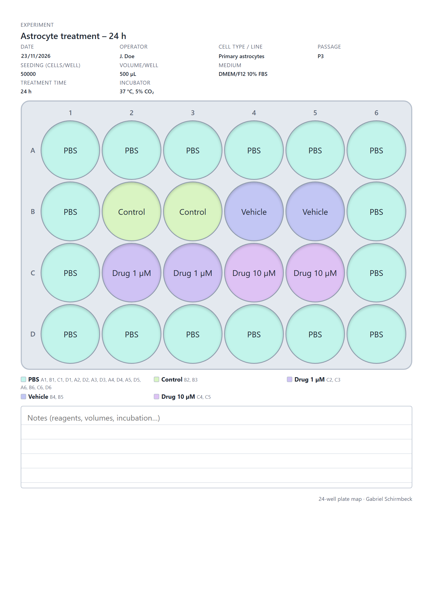
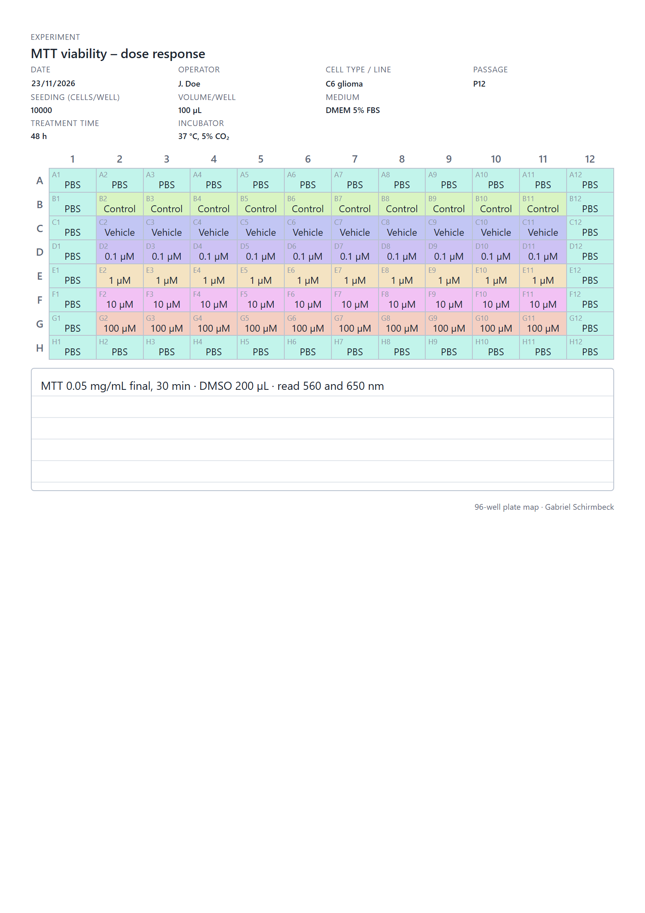
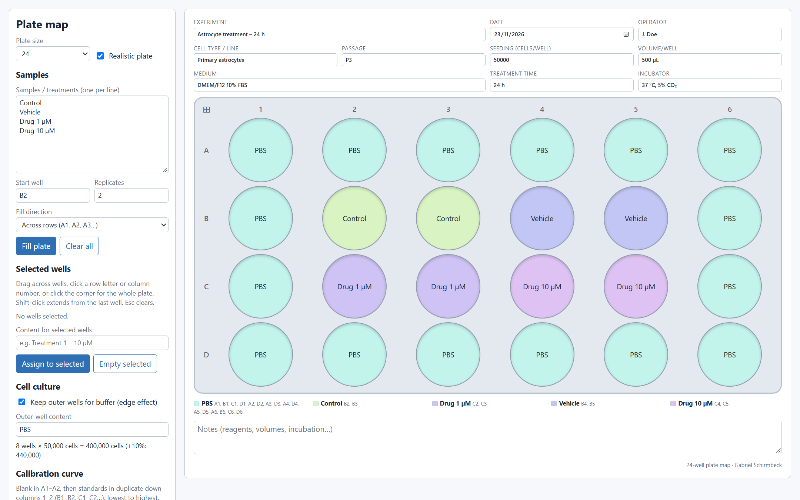

# Plate Map

A single-file web tool for planning **cell culture and assay plates** and printing a clean **A4 plate map** for the bench.
No installation, no account, no server: open `index.html` in any browser.

## Features

- **Plate sizes:** 6, 12, 24, 48 and 96 wells. Switching size keeps the content of wells that still exist.
- **Fast filling:** paste a list of samples or treatments, choose the number of replicates and a start well, then fill:
  - across rows (A1, A2, A3…)
  - down columns (A1, B1, C1…)
  - replicates side by side, samples down (Sample 1 in A1–A2, Sample 2 in B1–B2…)
- **Select wells with the mouse:** drag across a block, click a row letter or column number, or click the corner for the whole plate. Then assign one content to all selected wells.
- **Calibration curves in one click:** the blank goes in A1–A2, then standards in duplicate down the columns, lowest to highest. Longer curves continue in columns 3–4. Built-in curves:

  | Assay | Standards | Range |
  |---|---|---|
  | Lowry (Peterson) – proteins | 9 | 2–40 µg |
  | ELISA GFAP | 8 | 0.1–10 ng |
  | ELISA S100B – protocol 1 | 10 | 0.00195–1 ng/mL |
  | ELISA S100B – protocol 2 | 10 | 0.0195–10 ng/mL |
  | Glutamine synthetase activity | 7 | 0.156–10 mM |
  | GSH | 10 | 0.977–500 µM |

- **Your own curves:** enter a name and either a list of values or a serial dilution (top concentration, dilution factor, number of points). The curve is saved to the list for next time.
- **Cell culture:** keep the outer wells for PBS or medium (edge effect). The sheet has fields for cell type, passage, seeding density, volume per well, medium, treatment time and incubator. A seeding calculator gives the total number of cells needed.
- **Realistic plate view:** round, recessed wells on a plate body, on screen and in print.
- **Printing:** one A4 portrait page. Rows are only as tall as their content, empty fields are left out, and there's an optional sample list and a ruled notes box for handwriting.
- **Export CSV** with one row per well (`Well, Row, Column, Content`).
- **Autosave:** the current plate is kept in your browser between visits.

## Examples

| Lowry protein assay | ELISA S100B (realistic view) |
|---|---|
|  |  |
| Curve in columns 1–4, 24 samples in duplicate side by side. | Protocol 2 curve, treatments in duplicate, realistic wells. |

| Cell culture, 24-well | MTT dose response, 96-well |
|---|---|
|  |  |
| Outer wells kept for PBS, culture details filled in. | Edge wells with PBS, 6 conditions × 10 wells, sample list switched off. |

Click a picture to open the printed PDF. The realistic view on screen:

## How to use

1. Download `index.html` and open it in Chrome, Edge or Firefox. You can also open it from GitHub Pages if it's enabled for this repository.
2. Choose the plate size, then add a calibration curve, fill samples, or select wells and assign content.
3. Fill in the experiment details on the sheet. Click any well to edit it by hand.
4. Click **Print** and choose A4, portrait, with background graphics on.

## Notes

- Everything stays in your browser. Nothing is uploaded anywhere.
- Saved plates and custom curves are stored per browser. They don't move between computers or browsers, and clearing site data removes them. Use **Export CSV** to keep a copy.
- Check concentrations against your own protocol before use. The built-in curves follow the protocols they were taken from.

---

Made by Gabriel Schirmbeck.
